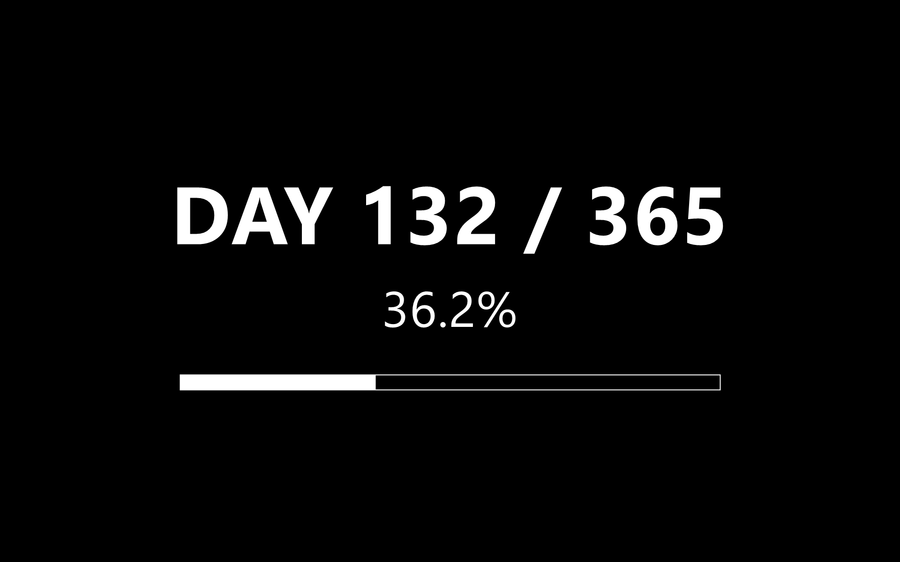

# Year Progress Wallpaper
### *A Mostly Harmless Reminder That Time Is Doing Exactly What Time Does*

It is a curious fact, often remarked upon by people who have nothing better to do, that the year seems to be going faster than it did last year. This is, of course, not true. The year is proceeding at precisely the same speed it has always proceeded, which is one year per year, give or take the occasional leap second the Earth chips in to keep things tidy. What has changed is *you*, and there is very little that can be done about that.

This is a small program for Microsoft Windows that paints your desktop wallpaper and lock screen a tasteful and uncompromising shade of black, then writes on top of it - in white letters - precisely how far through the year you are. It does this every day at midnight, or as close to midnight as your computer can manage, taking into account that it may have been switched off, asleep, or quietly contemplating its place in the universe.

The reasons for wanting such a thing on one's desktop are many and varied, and probably best not examined too closely.



## What It Does

- Produces a black PNG, of the exact dimensions of your primary display, with white text reading `DAY <n> / <total>`, the percentage of the year that has slipped quietly away while you were doing other things, and a small horizontal bar that fills up from left to right as the year does likewise.
- Sets this image as your **desktop wallpaper** (by way of `SystemParametersInfo`, an API older than several countries still on the map) and your **lock screen** (by way of a WinRT call called `LockScreen.SetImageFileAsync`, which is the sort of name only a committee could have produced, and almost certainly did).
- Re-renders itself daily at 00:00 via a Scheduled Task. If the machine happens to be switched off at the appointed hour, the Scheduled Task will - with admirable patience - wait until the machine is once again available, and then quietly do the thing it was supposed to do, as though nothing had happened.

## Requirements

- A computer running Microsoft Windows, version 10 or 11. Earlier versions are not supported and have, in any case, gone to a better place.
- **Windows PowerShell 5.1.** This is the version of PowerShell that ships with Windows by default, and despite Microsoft having released a much newer one called PowerShell 7, the older one is required here for a single, specific reason: the WinRT type projection used by the lock-screen call exists only in 5.1. PowerShell 7 contains, in its place, a polite but firm absence. The script handles this gracefully - run it under pwsh 7 and the desktop wallpaper updates normally, the lock-screen step is quietly skipped, and nobody mentions it again.

## A Note on `-ExecutionPolicy Bypass`

Windows would, by default, prefer that you not run unsigned PowerShell scripts downloaded from the internet, which is on the whole a sensible position for an operating system to take. `-ExecutionPolicy Bypass` overrides that preference for one process only: it does not alter your system-wide policy and it does not affect any other PowerShell session.

You are, however, strongly encouraged to read the `.ps1` files before running them. They are short, they do precisely what this document claims, and running `-ExecutionPolicy Bypass` commands from the internet without first looking at them is the sort of behaviour that has historically not ended well for anyone.

## Install

```powershell
git clone https://github.com/BennyWaitWhat/year-progress-wallpaper.git
cd year-progress-wallpaper
powershell.exe -ExecutionPolicy Bypass -File .\install.ps1
```

In approximately the time it takes to put the kettle on, the installer will:

1. Copy `Update-Wallpaper.ps1` to `%LOCALAPPDATA%\YearProgressWallpaper\`, which is the part of your hard disk Windows has set aside for things it would rather you didn't have to look at.
2. Register a Scheduled Task called `YearProgressWallpaper`, which will perform its duties daily at midnight forever, or until you uninstall it, whichever comes first.
3. Run the script once on the spot, so you can see immediately that the thing works and was worth the trouble.

## Customize

There are two knobs at the top of `Update-Wallpaper.ps1`. They are knobs only in the metaphorical sense; in practice they are numbers you must edit with a text editor. The metaphor is, however, useful, and we shall persist with it.

| Knob | What it does | Default |
|------|--------------|---------|
| `$scale` | The size of everything. `1.0` is BOLD. `0.5` is half that. `0.34` is the size of things one would put on a wallpaper if one had to live with them every day. | `1.0` |
| `$alpha` | The opacity of the white ink, from `0` (invisible, and therefore arguably pointless) to `255` (assertively present). `128` is a pleasant ghost-of-a-thing. | `255` |

For a discreet, watermark-y look that does not shout at you every time you minimise something: `$scale = 0.34`, `$alpha = 128`.

Edit the file, then either re-run `install.ps1` (which overwrites itself in good faith) or edit the installed copy at `%LOCALAPPDATA%\YearProgressWallpaper\Update-Wallpaper.ps1` and run it directly.

The text is centred vertically. The Windows lock-screen clock sits above this region and, in a rare display of inter-process courtesy, does not overlap.

## Uninstall

```powershell
powershell.exe -ExecutionPolicy Bypass -File .\uninstall.ps1
```

This removes the Scheduled Task and the folder it was using. The wallpaper and lock-screen *settings*, however, will still be pointing hopefully at a file that no longer exists - a state of affairs they are perfectly capable of persisting in for years if nobody intervenes. Open **Settings > Personalization** and pick a replacement, or don't, and watch the universe shrug.

## How It Works

For those interested in the mechanism, which is the sort of person who reads README files all the way through:

- `Get-Date.DayOfYear` divided by the number of days in the year produces the percentage. Leap years are handled with the cool indifference they deserve.
- `System.Drawing` renders the PNG at whatever resolution `System.Windows.Forms.Screen` reports for your primary monitor.
- `SystemParametersInfo(SPI_SETDESKWALLPAPER)` performs an act of mild digital persuasion on the operating system.
- `Windows.System.UserProfile.LockScreen.SetImageFileAsync` performs a similar act on the lock screen, via WinRT, which is a thing Microsoft invented and then largely stopped talking about.
- A Scheduled Task with `Daily 00:00` + `StartWhenAvailable=True` ensures the whole performance happens again tomorrow, and the day after, and so on, until the heat death of the universe or until you uninstall it. Whichever you find more pressing.

Multi-monitor: only the primary display's resolution is used to size the PNG. Other monitors will receive the same image, scaled or cropped by Windows according to its own private logic, into which it is unwise to enquire.

## License

MIT - see [LICENSE](LICENSE). Which is to say: do what you like with it, but please do not blame me.
