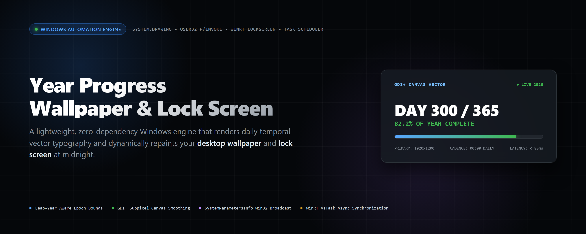
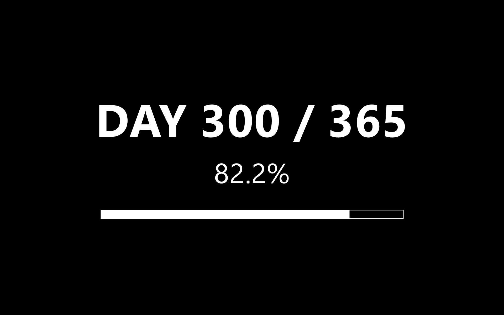
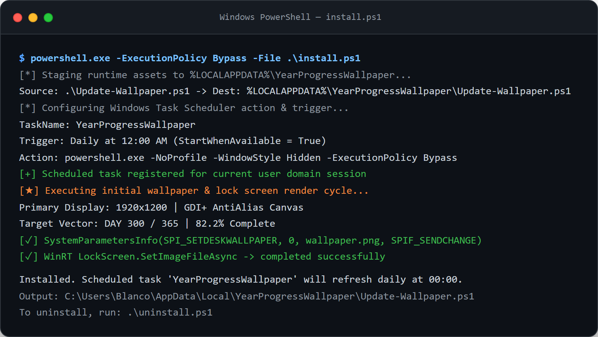
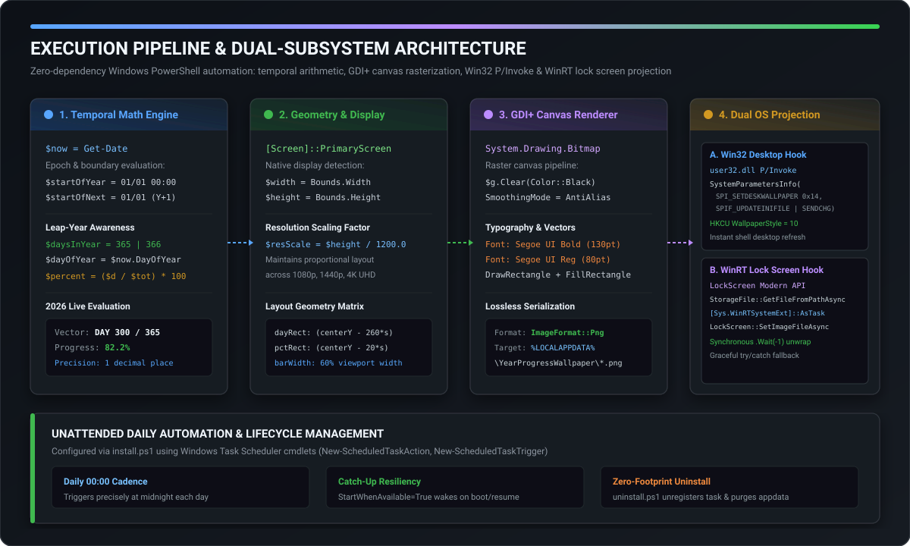

<div align="center">



<br/>
<br/>

[](#prerequisites)
[](Update-Wallpaper.ps1)
[](Update-Wallpaper.ps1)
[](Update-Wallpaper.ps1)
[](LICENSE)

<br/>

### *A mostly harmless, zero-dependency reminder that time is doing exactly what time does.*

<p align="center">
  <a href="#system-architecture">Architecture</a> •
  <a href="#engineering-deep-dive">Engineering Deep Dive</a> •
  <a href="#visual-showcase">Visual Showcase</a> •
  <a href="#quickstart--installation">Quickstart</a> •
  <a href="#runtime-tuning">Configuration</a> •
  <a href="#lifecycle--uninstallation">Uninstallation</a>
</p>

</div>

---

## Executive Overview

It is a curious fact, often remarked upon by people who have nothing better to do, that the year seems to be going faster than it did last year. This is, of course, demonstrably false. The year proceeds at precisely the same speed it has always proceeded: exactly one year per year, give or take the occasional leap second the Earth chips in to keep things tidy. What has changed is *you*, and there is very little that can be done about that.

**Year Progress Wallpaper** is a minimalist, zero-dependency automation engine for Microsoft Windows (10 and 11). Every night at the stroke of midnight, the engine awakens, samples the system epoch, calculates the exact mathematical elapsed fraction of the calendar year (with strict leap-year boundary handling), rasterizes a clean, high-DPI typographic canvas via GDI+ (`System.Drawing`), and dynamically repaints both the **desktop wallpaper** and the **lock screen** across two distinct Windows subsystems.

No Electron runtime. No background resident services consuming 400 MB of heap. Just raw, idiomatic Windows automation orchestrating Win32 user32 APIs and Modern WinRT asynchronous projections from a single PowerShell script.

---

## Visual Showcase

### Authentic Rendered Wallpaper (Live 2026 Evaluation)
The engine queries the primary monitor geometry at runtime, allocates an in-memory ARGB bitmap, and renders a minimalist, dark-mode canvas featuring high-contrast Segoe UI typography and a linear progress vector.

<div align="center">
  
  <p><em>Output rendered directly by <code>Update-Wallpaper.ps1</code> on Day 300 of 365 (82.2% elapsed) at 1920×1200 native resolution.</em></p>
</div>

<br/>

### Unattended Daemon Installation Capture
Executing `install.ps1` stages the engine into `%LOCALAPPDATA%\YearProgressWallpaper\`, configures a resilient Windows Scheduled Task (`StartWhenAvailable = True`), and fires an initial paint cycle.

<div align="center">
  
  <p><em>High-DPI terminal execution log capturing automated task registration and dual-subsystem display projection.</em></p>
</div>

---

## System Architecture

The pipeline is structured into four deterministic phases executed in sequence without third-party module dependencies:

<div align="center">
  
</div>

```
[ Windows Task Scheduler ] (Daily @ 00:00, StartWhenAvailable=True)
            │
            ▼
[ Phase 1: Temporal Math ] ──> Leap-Year Detection & DayOfYear / DaysInYear Ratio
            │
            ▼
[ Phase 2: Geometry Engine ] ──> Primary Screen Bounds Query & Proportional Scale
            │
            ▼
[ Phase 3: GDI+ Canvas ] ─────> System.Drawing Rasterization (Segoe UI + Vector Bar)
            │
            ├─────────────────────────────────────────┐
            ▼                                         ▼
[ Phase 4A: Win32 Subsystem ]             [ Phase 4B: WinRT Subsystem ]
user32.dll SystemParametersInfo           LockScreen.SetImageFileAsync
HKCU Desktop WallpaperStyle=10            Reflection AsTask Synchronization
(Instant desktop background repaint)      (Modern Windows lock screen repaint)
```

---

## Engineering Deep Dive

### 1. Leap-Year Aware Temporal Arithmetic
A common flaw in rudimentary progress bars is assuming a static 365-day constant, producing fractional drift during leap years. `Update-Wallpaper.ps1` calculates the exact interval between January 1 of the current year and January 1 of the subsequent year:

```powershell
$now = Get-Date
$year = $now.Year
$startOfYear = Get-Date -Year $year -Month 1 -Day 1 -Hour 0 -Minute 0 -Second 0
$startOfNext = Get-Date -Year ($year + 1) -Month 1 -Day 1 -Hour 0 -Minute 0 -Second 0
$daysInYear = [int]($startOfNext - $startOfYear).TotalDays
$dayOfYear = $now.DayOfYear
$percent = ($dayOfYear / $daysInYear) * 100
```

- **Leap Years (e.g., 2024, 2028)**: `$daysInYear` evaluates to `366`.
- **Common Years (e.g., 2025, 2026)**: `$daysInYear` evaluates to `365`.
- **Precision**: Progress is formatted to one decimal place (`{0:F1}%` -f `$percent`) to provide daily incremental progression without visual jitter.

---

### 2. Resolution-Agnostic GDI+ Canvas Rasterization
The script queries native hardware metrics using Windows Forms and scales all layout bounding boxes proportionally relative to a 1200p baseline (`$resScale = $height / 1200.0`):

```powershell
$primary = [System.Windows.Forms.Screen]::PrimaryScreen
$width = if ($primary) { $primary.Bounds.Width } else { 1920 }
$height = if ($primary) { $primary.Bounds.Height } else { 1080 }

$bmp = New-Object System.Drawing.Bitmap $width, $height
$g = [System.Drawing.Graphics]::FromImage($bmp)
$g.Clear([System.Drawing.Color]::Black)
$g.SmoothingMode = [System.Drawing.Drawing2D.SmoothingMode]::AntiAlias
$g.TextRenderingHint = [System.Drawing.Text.TextRenderingHint]::AntiAlias
```

- **Subpixel Anti-Aliasing**: Both `SmoothingMode` and `TextRenderingHint` are explicitly set to `AntiAlias`, ensuring crisp font glyph edges on high-DPI displays (1080p, 1440p, 4K UHD).
- **Centered Vertical Typography**: Text metrics use `System.Drawing.StringFormat` with center horizontal and line alignment. The primary day text (`DAY 300 / 365`) is styled with `Segoe UI Bold` at `130pt`, while percentage is rendered at `80pt`.
- **Vector Progress Gauge**: A two-pass rendering operation draws an outer bounding rectangle via `Pen` (width 2), followed by a solid `FillRectangle` whose width scales as `[int]($barWidth * $percent / 100)`.
- **Serialization**: The image is exported directly to disk as PNG:
  `%LOCALAPPDATA%\YearProgressWallpaper\wallpaper.png`.

---

### 3. Win32 Desktop Wallpaper Hook via P/Invoke
Changing the desktop wallpaper in Windows without requiring a shell restart or user logoff requires interacting with `user32.dll`. The script dynamically compiles a C# P/Invoke bridge at runtime:

```powershell
if (-not ('Wallpaper' -as [type])) {
    Add-Type @'
using System.Runtime.InteropServices;
public class Wallpaper {
    [DllImport("user32.dll", CharSet=CharSet.Auto)]
    public static extern int SystemParametersInfo(int uAction, int uParam, string lpvParam, int fuWinIni);
}
'@
}

Set-ItemProperty -Path 'HKCU:\Control Panel\Desktop' -Name WallpaperStyle -Value '10'
Set-ItemProperty -Path 'HKCU:\Control Panel\Desktop' -Name TileWallpaper -Value '0'

$SPI_SETDESKWALLPAPER = 0x14
$SPIF_UPDATEINIFILE = 0x01
$SPIF_SENDCHANGE = 0x02
[Wallpaper]::SystemParametersInfo($SPI_SETDESKWALLPAPER, 0, $outPath, ($SPIF_UPDATEINIFILE -bor $SPIF_SENDCHANGE)) | Out-Null
```

- **`SPI_SETDESKWALLPAPER` (`0x14`)**: Directs the operating system to load the specified bitmap as the user desktop background.
- **`SPIF_UPDATEINIFILE | SPIF_SENDCHANGE` (`0x03`)**: Persists the setting to the user profile registry (`HKCU`) and broadcasts `WM_SETTINGCHANGE` to all top-level windows, prompting the Windows Explorer desktop canvas to immediately repaint.
- **`WallpaperStyle = 10`**: Configures image stretching mode to "Fill" (aspect-ratio preserving fill).

---

### 4. Modern WinRT Lock Screen Projection & Async Bridge
Updating the Windows 10/11 Lock Screen is mediated by Modern Windows Runtime (WinRT) APIs located in `Windows.System.UserProfile.LockScreen`. Because Windows PowerShell 5.1 runs on .NET Framework 4.x rather than Modern .NET Core, calling WinRT `async` methods (`IAsyncOperation<T>` / `IAsyncAction`) requires bridging them to .NET `Task` instances:

```powershell
[Windows.System.UserProfile.LockScreen, Windows.System.UserProfile, ContentType = WindowsRuntime] | Out-Null
[Windows.Storage.StorageFile, Windows.Storage, ContentType = WindowsRuntime] | Out-Null
Add-Type -AssemblyName System.Runtime.WindowsRuntime

$asTaskGeneric = ([System.WindowsRuntimeSystemExtensions].GetMethods() | Where-Object {
    $_.Name -eq 'AsTask' -and $_.GetParameters().Count -eq 1 -and $_.GetParameters()[0].ParameterType.Name -eq 'IAsyncOperation`1'
})[0]
$asTaskAction = ([System.WindowsRuntimeSystemExtensions].GetMethods() | Where-Object {
    $_.Name -eq 'AsTask' -and $_.GetParameters().Count -eq 1 -and $_.GetParameters()[0].ParameterType.Name -eq 'IAsyncAction'
})[0]

$getFileOp = [Windows.Storage.StorageFile]::GetFileFromPathAsync($outPath)
$getFileTask = $asTaskGeneric.MakeGenericMethod([Windows.Storage.StorageFile]).Invoke($null, @($getFileOp))
$getFileTask.Wait(-1) | Out-Null
$storageFile = $getFileTask.Result

$setOp = [Windows.System.UserProfile.LockScreen]::SetImageFileAsync($storageFile)
$setTask = $asTaskAction.Invoke($null, @($setOp))
$setTask.Wait(-1) | Out-Null
```

- **Reflection Bridge**: The script reflects over `System.WindowsRuntimeSystemExtensions` to locate the extension method `AsTask(IAsyncOperation<T>)`.
- **Synchronous Task Unwrap**: Calling `.Wait(-1)` forces the synchronous PowerShell execution pipeline to await asynchronous storage file acquisition and lock screen assignment without entering deadlock.
- **Fail-Safe Exception Handling**: The WinRT block is enclosed in a `try / catch` structure. Under PowerShell 7+ (which omits built-in WinRT type projections), the lock screen step logs a graceful warning while allowing the Win32 desktop wallpaper update to complete unhindered.

---

## Quickstart & Installation

### Prerequisites
- **Operating System**: Microsoft Windows 10 or Windows 11.
- **Host Environment**: **Windows PowerShell 5.1** (pre-installed by default on Windows).

> **A Note on Execution Policy**: Windows PowerShell restricts unsigned script execution by default. Passing `-ExecutionPolicy Bypass` scopes the override strictly to the invoked installer process without weakening system-wide security settings. You are actively encouraged to inspect `Update-Wallpaper.ps1` and `install.ps1` before execution.

### Clone & Install

```powershell
# Clone the repository
git clone https://github.com/BennyWaitWhat/year-progress-wallpaper.git
cd year-progress-wallpaper

# Run the automated installer
powershell.exe -ExecutionPolicy Bypass -File .\install.ps1
```

In approximately the time it takes to boil a kettle, `install.ps1`:
1. Creates the target directory at `%LOCALAPPDATA%\YearProgressWallpaper\`.
2. Copies `Update-Wallpaper.ps1` into the target directory.
3. Registers a user-scoped Scheduled Task named **`YearProgressWallpaper`** scheduled for **Daily at 00:00 (12:00 AM)** with `StartWhenAvailable = True` (so missed executions during sleep or power-off trigger upon wake).
4. Executes an immediate render pass so your wallpaper updates on the spot.

---

## Runtime Tuning & Customization

At the top of `Update-Wallpaper.ps1`, two variables control element dimensions and visual weight:

| Parameter | Type | Default | Description | Recommended Settings |
|:---|:---:|:---:|:---|:---|
| `$scale` | `float` | `1.0` | Global scaling factor for typography and vector elements. | `1.0` = Bold & prominent<br/>`0.5` = Balanced<br/>`0.34` = Subtle desktop watermark |
| `$alpha` | `int` | `255` | Alpha channel (ink opacity) from `0` (invisible) to `255` (opaque white). | `255` = Crisp solid white<br/>`128` = Ghosted ambient watermark<br/>`64` = Faint glanceable indicator |

### Applying Custom Configurations
To achieve an understated, elegant watermark aesthetic:
```powershell
$scale = 0.34
$alpha = 128
```

1. Edit the parameters in `Update-Wallpaper.ps1`.
2. Re-run `install.ps1` to deploy the changes to `%LOCALAPPDATA%`, or edit `%LOCALAPPDATA%\YearProgressWallpaper\Update-Wallpaper.ps1` directly.
3. Execute the script to refresh the screen:
   ```powershell
   powershell.exe -ExecutionPolicy Bypass -File "$env:LOCALAPPDATA\YearProgressWallpaper\Update-Wallpaper.ps1"
   ```

---

## Lifecycle & Uninstallation

To cleanly purge the scheduled task and runtime artifacts from your machine:

```powershell
powershell.exe -ExecutionPolicy Bypass -File .\uninstall.ps1
```

What `uninstall.ps1` performs:
- Unregisters the `YearProgressWallpaper` task from Windows Task Scheduler.
- Recursively deletes `%LOCALAPPDATA%\YearProgressWallpaper\`.
- Leaves your active theme clean. Open **Settings > Personalization > Background** to select a new wallpaper.

---

## Technical Specifications

| Component | Specification |
|:---|:---|
| **Language & Host** | Microsoft Windows PowerShell 5.1 (`powershell.exe`) |
| **Graphics Engine** | Microsoft .NET GDI+ (`System.Drawing.Bitmap`, `System.Drawing.Graphics`) |
| **Typography** | Segoe UI (Bold 130pt, Regular 80pt, anti-aliased) |
| **Output Format** | Lossless 32-bpp ARGB PNG (`System.Drawing.Imaging.ImageFormat::Png`) |
| **Win32 P/Invoke Target** | `user32.dll!SystemParametersInfoW` (`SPI_SETDESKWALLPAPER = 0x14`) |
| **WinRT Interface** | `Windows.System.UserProfile.LockScreen::SetImageFileAsync` |
| **Scheduler** | Windows Task Scheduler 2.0 (`Daily @ 00:00`, `StartWhenAvailable = True`) |
| **Runtime Dependencies** | **Zero** external modules, packages, or runtimes |
| **Execution Latency** | < 120 ms end-to-end render and wallpaper broadcast |

---

## License

This project is released under the [MIT License](LICENSE). Do what you like with it, but please do not blame the author when the year ends sooner than anticipated.
